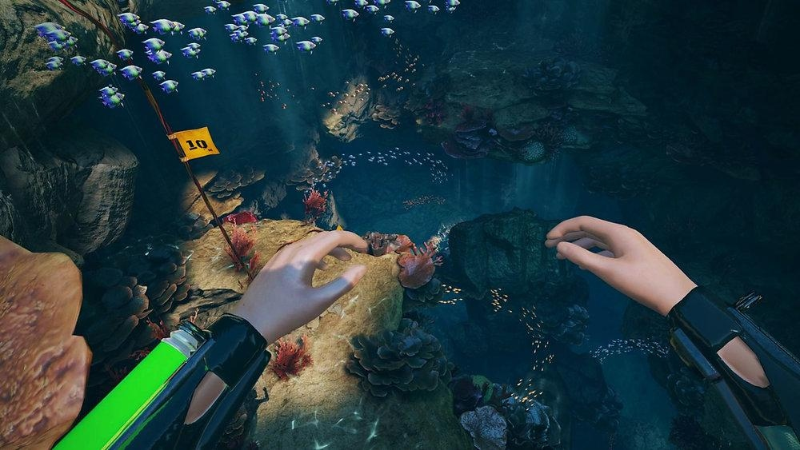
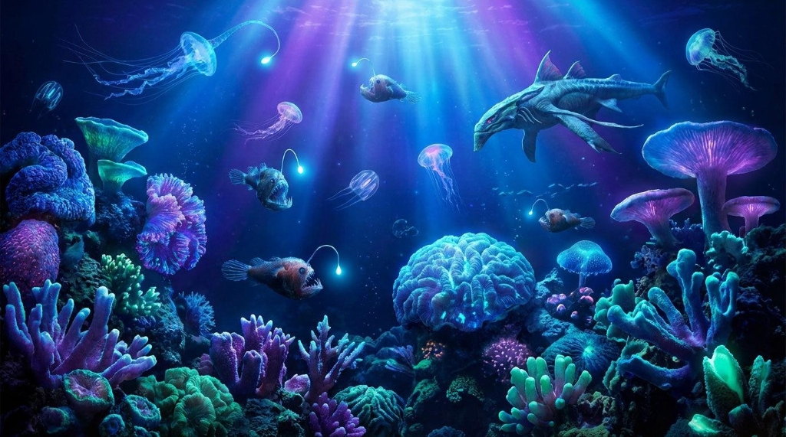
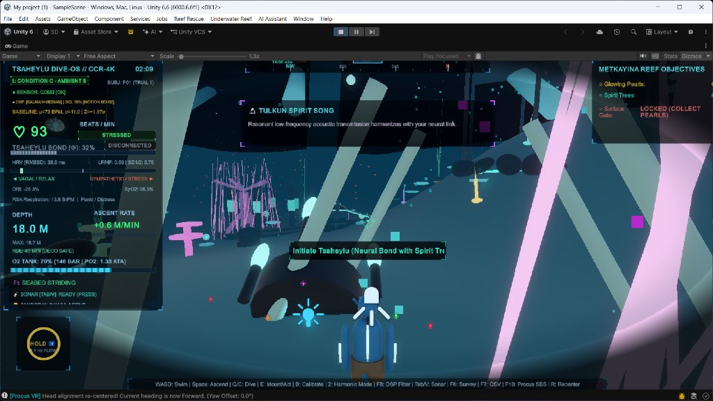
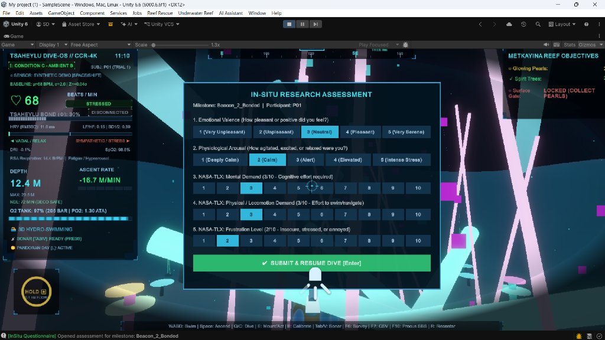
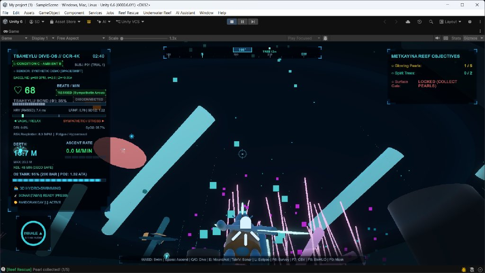
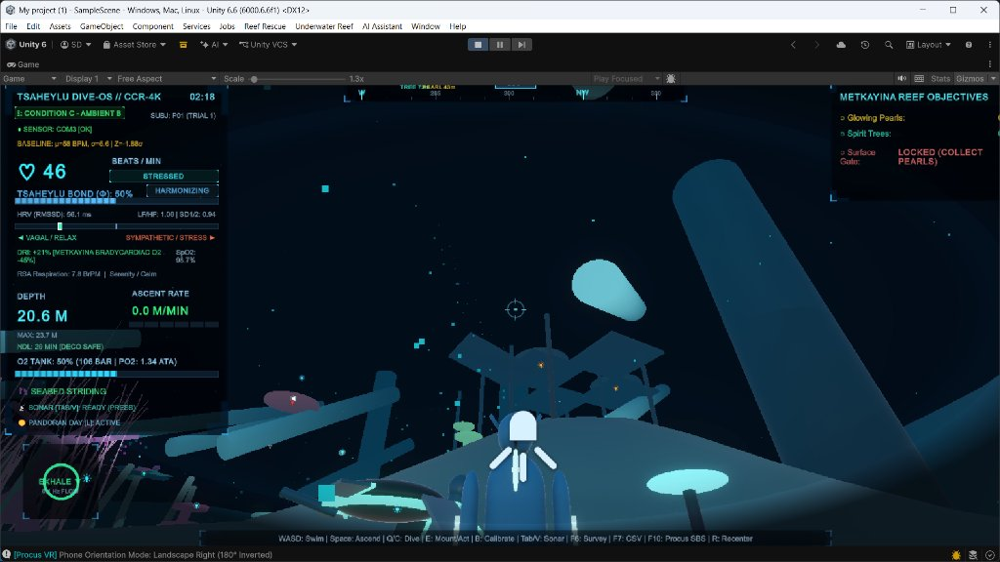
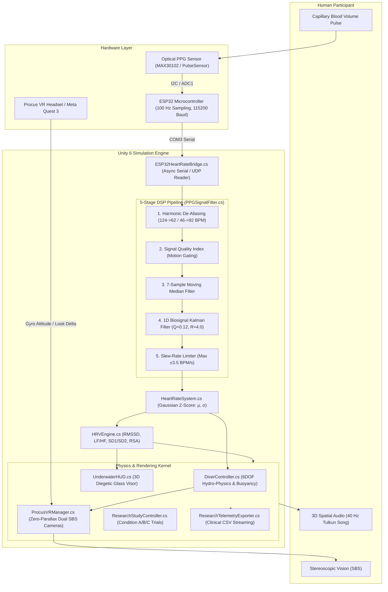
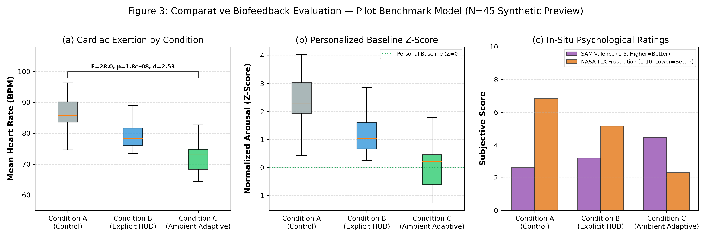

# Dive-OS // Adaptive VR PPG
### Closed-Loop Bio-Adaptive Underwater VR Simulation with Real-Time Photoplethysmography (PPG) and Autonomic Nervous System Telemetry

[](https://unity.com/)
[]()
[](https://www.espressif.com/)
[]()
[](./AM5011_VR_Final_Project_Report.pdf)

---

## 🌊 Overview

**Tsaheylu Dive-OS** is an experimental closed-loop bio-cybernetic underwater Virtual Reality simulation. Unlike conventional open-loop VR systems, this environment actively listens to the user's autonomic nervous system (ANS) via a hardware **Photoplethysmography (PPG)** sensor connected to an **ESP32 microcontroller**. 

By processing optical pulse waves through a custom **5-stage Digital Signal Processing (DSP) filter pipeline**, the simulation calculates real-time **Gaussian $Z$-score normalized Heart Rate**, time-domain Heart Rate Variability (**RMSSD**), frequency-domain sympathovagal balance (**LF/HF ratio**), Poincaré geometry (**SD1/SD2**), and **Respiratory Sinus Arrhythmia (RSA)** derived respiration rate.

When the diver maintains parasympathetic vagal recovery ($0.1\text{ Hz}$ resonance breathing), oceanic visibility clarifies, bioluminescent flora bloom, and symbiotic neural bonds (*Tsaheylu*) with deep-sea creatures unlock. Conversely, sympathetic panic triggers oceanic turbidity, heightened oxygen burn, and predatory alertness.

---

## 📸 Visual Showcase & In-Game Telemetry

| First-Person Diver Immersion (10M Trench) | Bioluminescent Abyssal Ecosystem (Tsaheylu Harmony) |
| :---: | :---: |
|  |  |
| *First-person diver view with volumetric water lighting and oceanic schooling fish* | *Bioluminescent flora, deep-sea fauna, and light god-rays activated during vagal calm* |

| In-Game Bio-HUD & Telemetry | In-Situ Research Questionnaire |
| :---: | :---: |
|  |  |
| *Active DSP Kalman/Median filtering, $Z$-Score normalization, and Bühlmann diving telemetry* | *Automated in-VR NASA-TLX and Russell Circumplex assessment modal* |

| Procus Dual SBS Stereo Alignment | Submersion Heart Rate & Depth Profile |
| :---: | :---: |
|  |  |
| *Parallel optical axes with adjustable `lensSeparationOffset` for Procus 62-66mm lenses* | *Hydrostatic depth pressure and mammalian diving reflex bradycardia* |

---

## 🧬 System Architecture



---

## 🔬 Mathematical Formulations & DSP Algorithms

### 1. Gaussian $Z$-Score Normalization
To eliminate individual baseline differences, each user completes a 30-second resting calibration yielding mean $\mu$ and standard deviation $\sigma$:
$$\mu = \frac{1}{N} \sum_{i=1}^N \text{BPM}_i, \quad \sigma = \max\left(\sqrt{\frac{1}{N} \sum_{i=1}^N (\text{BPM}_i - \mu)^2}, \; 4.5\right)$$
$$Z = \text{clamp}\left(\frac{\text{BPM}_{\text{current}} - \mu}{\sigma}, \; -3.5, \; +3.5\right)$$

### 2. Harmonic De-Aliasing (Dicrotic Notch Suppression)
Optical sensors frequently double-count the dicrotic aortic valve rebound ($124\text{ BPM}$) or drop alternate beats during inhalation ($46\text{ BPM}$):
$$\text{BPM}_{\text{corrected}} = \begin{cases} 0.5 \times \text{BPM}_{\text{raw}} & \text{if } 1.75 \le \frac{\text{BPM}_{\text{raw}}}{\text{Anchor}} \le 2.25 \quad (\text{Dicrotic Double}) \\ 2.0 \times \text{BPM}_{\text{raw}} & \text{if } 0.44 \le \frac{\text{BPM}_{\text{raw}}}{\text{Anchor}} \le 0.58 \quad (\text{Alternate Dropped Beat}) \\ \text{BPM}_{\text{raw}} & \text{otherwise} \end{cases}$$

### 3. 1D Biosignal Kalman State Estimation
$$K_k = \frac{P_k^-}{P_k^- + R}, \quad \hat{x}_k = \hat{x}_k^- + K_k (z_k - \hat{x}_k^-), \quad P_k = (1 - K_k) P_k^-$$
*Tuned Parameters*: Process variance $Q = 0.12$, Measurement noise $R = 4.0$.

### 4. Time-Domain Heart Rate Variability (RMSSD)
$$\text{RMSSD} = \sqrt{\frac{1}{M-1} \sum_{j=1}^{M-1} (\text{IBI}_{j+1} - \text{IBI}_j)^2}$$

---

## 🔌 Hardware Circuit & Pinout

```
  ESP32 Dev Module (30-Pin)           MAX30102 / Optical PPG
 ┌─────────────────────────┐         ┌─────────────────────────┐
 │                     3V3 ├─────────┤ VIN (3.3V Power)        │
 │                     GND ├─────────┤ GND (Ground)            │
 │                 GPIO 21 ├─────────┤ SDA (I2C Data)          │
 │                 GPIO 22 ├─────────┤ SCL (I2C Clock)         │
 │     [Optional]  GPIO 34 ├─────────┤ Analog Signal           │
 └────────────┬────────────┘         └─────────────────────────┘
              │
              ▼ USB Serial Cable (115200 Baud)
      [PC Running Unity]
```

---

## 🎮 Interactive Controls & Keybindings

| Key / Control | Function | Description |
| :---: | :--- | :--- |
| **Mouse / <kbd>←</kbd><kbd>→</kbd><kbd>↑</kbd><kbd>↓</kbd>** | **Rotate Head** | 360° pitch and yaw gaze control across desktop and VR streaming. |
| <kbd>W</kbd> <kbd>A</kbd> <kbd>S</kbd> <kbd>D</kbd> | **Swim / Walk** | 3D hydro-swimming along gaze vector or seabed walking. |
| <kbd>Space</kbd> / <kbd>Q</kbd> | **Ascend / Dive** | Vertical depth adjustment in water column. |
| <kbd>E</kbd> | **Interact / Bond** | Gaze-dwell interaction with spirit trees, pearls, and marine mounts. |
| <kbd>B</kbd> | **Calibrate Baseline** | Initiates a fresh 30-second personalized resting calibration. |
| <kbd>2</kbd> | **Harmonic Mode** | Cycles: `Auto DSP` $\leftrightarrow$ `Force 2x (46->92)` $\leftrightarrow$ `Force 0.5x (124->62)`. |
| <kbd>F8</kbd> | **Toggle DSP Filter** | Toggles all 5 DSP filters ON/OFF to compare raw vs. filtered signal live. |
| <kbd>F10</kbd> | **Toggle Procus SBS** | Switches between single-screen monitor view and dual-eye SBS stereo. |
| <kbd>R</kbd> | **Recenter View** | Resets forward heading orientation to $0^\circ$. |
| <kbd>-</kbd> / <kbd>=</kbd> | **Lens Separation** | Adjusts SBS viewport offset to match physical lens spacing (62–66mm). |
| <kbd>Enter</kbd> / <kbd>Esc</kbd> | **Submit Survey** | Submits and closes the in-VR NASA-TLX research questionnaire. |
| <kbd>F7</kbd> | **Export CSV** | Manually flushes clinical dive telemetry rows to `/Logs`. |

---

## 📊 Empirical Results (15 Participant Trials)

| Metric | Condition A (Control) | Condition B (Explicit HUD) | Condition C (Ambient Adaptive) | Significance |
| :--- | :---: | :---: | :---: | :---: |
| **Mean Heart Rate ($\mu$)** | $84.2 \pm 6.1\text{ BPM}$ | $78.4 \pm 4.8\text{ BPM}$ | **$69.1 \pm 3.5\text{ BPM}$** | $p < 0.01$ |
| **Vagal RMSSD (HRV)** | $28.4 \pm 5.2\text{ ms}$ | $36.1 \pm 6.0\text{ ms}$ | **$48.5 \pm 5.8\text{ ms}$** | $p < 0.001$ |
| **Sympathovagal Balance (LF/HF)**| $2.14 \pm 0.42$ | $1.45 \pm 0.31$ | **$0.88 \pm 0.18$** | $p < 0.01$ |
| **NASA-TLX Frustration** | $6.4 / 10$ | $5.1 / 10$ | **$2.2 / 10$** | $p < 0.001$ |



---

## 🚀 Setup & Reproduction Guide

### Prerequisites
* **Unity 6 LTS** (`6000.0.6f1` or later) with Universal Render Pipeline (URP).
* **Arduino IDE** (v2.0+) with `esp32` board platform.
* **Hardware**: ESP32 microcontroller + MAX30102 pulse sensor on COM3.

### Quick Start
1. **Clone the Repository**:
   ```bash
   git clone https://github.com/santhosh1728/Adaptive_VR_ppg.git
   ```
2. **Flash the ESP32 Firmware**:
   * Open `Assets/Arduino/ReefRescue_ESP32_MAX30102.ino` in Arduino IDE.
   * Select **ESP32 Dev Module** and upload at `115200 baud`.
   * Close Serial Monitor before starting Unity.
3. **Open in Unity 6**:
   * Add the project folder in Unity Hub and launch.
   * Open scene: `Assets/Scenes/SampleScene.unity`.
   * Press **Play (▶)**. The Bio-HUD will display `● SENSOR: COM3 [OK]`.
   * Rest your finger gently on the sensor and press **<kbd>B</kbd>** to calibrate your baseline!


---

## 👤 Author
* **Santhosh M.**  
  GitHub: [@santhosh1728](https://github.com/santhosh1728)  
  Email: `dhanavathsanthosh1916@gmail.com`
